<picture><source media="(prefers-color-scheme: dark)" srcset="assets/hero-dark.svg"></picture>

<picture><source media="(prefers-color-scheme: dark)" srcset="assets/social-l-dark.svg"></picture><a href="https://t.me/KarasichekMC"><picture><source media="(prefers-color-scheme: dark)" srcset="assets/social-1-dark.svg"></picture></a><a href="https://discord.com/karasichekMC"><picture><source media="(prefers-color-scheme: dark)" srcset="assets/social-2-dark.svg"></picture></a><a href="https://x.com/KarasichekMC"><picture><source media="(prefers-color-scheme: dark)" srcset="assets/social-3-dark.svg"></picture></a><a href="https://ko-fi.com/karasichek"><picture><source media="(prefers-color-scheme: dark)" srcset="assets/social-4-dark.svg"></picture></a><picture><source media="(prefers-color-scheme: dark)" srcset="assets/social-r-dark.svg"></picture>

<a href="https://github.com/Karasichek/cromite"><picture><source media="(prefers-color-scheme: dark)" srcset="assets/project-cromite-dark.svg"></picture></a>&nbsp;<a href="https://github.com/Karasichek/termux-nightly"><picture><source media="(prefers-color-scheme: dark)" srcset="assets/project-termux-nightly-dark.svg"></picture></a>

<a href="https://github.com/Karasichek/tgxiki"><picture><source media="(prefers-color-scheme: dark)" srcset="assets/project-tgxiki-dark.svg"></picture></a>&nbsp;<a href="https://github.com/Karasichek/struct"><picture><source media="(prefers-color-scheme: dark)" srcset="assets/project-struct-dark.svg"></picture></a>

<picture><source media="(prefers-color-scheme: dark)" srcset="assets/stack-dark.svg"></picture>

<picture><source media="(prefers-color-scheme: dark)" srcset="assets/wave-dark.svg"></picture>

<a href="https://metawka.github.io/expressive-profile/?from=karasichek"><picture><source media="(prefers-color-scheme: dark)" srcset="assets/credit-dark.svg"></picture></a>

